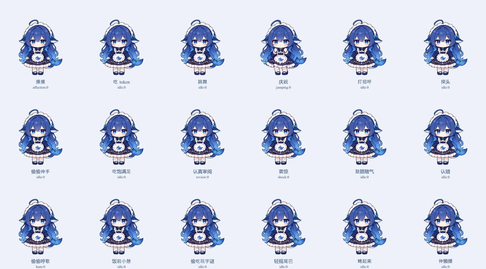
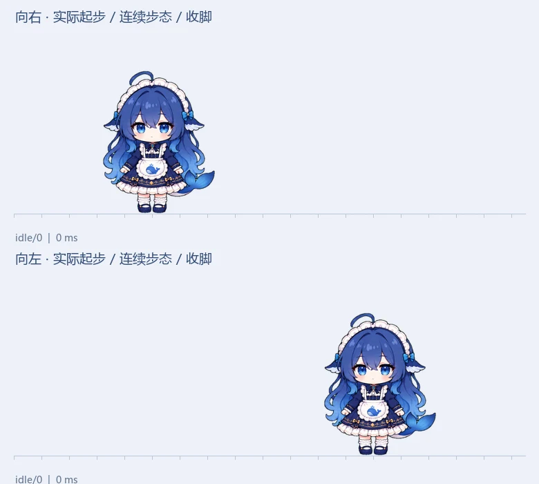
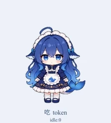

# 大肥鱼桌宠 · 统一形象修改版

Windows x64 桌面伙伴，支持拖动、散步、喂食、专注计时和可选 AI 聊天。本版为 **3.1.0-codex.1**，基于 [YunYueSama/codex-deepseek-pet](https://github.com/YunYueSama/codex-deepseek-pet) 修改，重点修正角色一致性、动作切换和按钮对应关系。

这是独立修改版，不是原作者或 DeepSeek 官方发布的版本。

[下载 Windows 版](https://github.com/michael030528/codex-deepseek-pet/releases/latest) · [修改说明](docs/修改版说明.md) · [反馈问题](https://github.com/michael030528/codex-deepseek-pet/issues)



## 这版改了什么

- **统一角色形象。** 以同一标准站姿校准脸型、蓝色发色和身体尺度；吃口粮重画为接过 token、送到嘴边、咀嚼、收手。偷吃时保持同一尺寸，弯腰自然变矮。
- **补齐小表情。** 18 个按钮按名称播放对应动作，摸摸、震惊、伸懒腰、小憩、抱膝蜷起等不再复用含义不符的姿势。
- **完整收势再切换。** 打断动作时先收手或放下道具；小憩、蜷缩和睡眠结束时先起身。从睡眠切入短动作后，散步等待实际动画结束。
- **统一左右步幅。** 起步移除旧大跨步姿势，改用低抬脚步态；步频按实际移动路程与角色尺寸推进，停步从当前帧收脚，避免跳回不相关姿势。
- **每次绘制一张完整原画。** 不使用光流变形、两张角色叠化或身体拉伸。位置与整体倾斜以 60 Hz 为更新目标，**不代表每秒有 60 张独立姿势**。

当前预载 25 张图集中的 142 个实际使用帧。多数动作使用离散关键姿势，尚非每个动作都具备密集过渡原画。





## 下载与启动

从 [Releases](https://github.com/michael030528/codex-deepseek-pet/releases/latest) 下载 Windows x64 ZIP，完整解压后双击 `codex-deepseek-pet.exe`。无需安装 Node.js；请保留解压后的整个文件夹，不要只移动 EXE。

升级前先从托盘退出旧版，再启动新版。

| 操作 | 功能 |
| --- | --- |
| 单击 / 空格 | 摸摸 |
| 双击 / 回车 | 打开陪伴面板 |
| 按住拖动 | 移动桌宠，松手后下落 |
| F | 喂一口 token |
| 右键 / 托盘图标 | 控制菜单 |
| Ctrl + Alt + P | 切换鼠标穿透 |

## 可选聊天功能

基础桌宠互动可以离线使用。需要聊天时，在「习惯与设置」填写你自己的兼容服务地址、模型名称和 API 密钥。

仓库和下载包不附带维护者的 API 密钥、本机连接配置、保存的偏好或聊天记录。密钥由 Windows 本机加密保存；源码仅保留通用接入功能。画面分享默认关闭，手动分享需要先预览。

## 从源码运行

需要 Node.js 20 或更新版本。

```bash
git clone https://github.com/michael030528/codex-deepseek-pet.git
cd codex-deepseek-pet
npm ci
npm start
```

检查与打包：

```bash
npm run check
npm test
npm run test:electron
npm run pack
```

`npm run dist` 可生成 Windows 安装包和便携 EXE，输出位于 `artifacts/`。仓库已包含运行所需图集，普通开发不需要重新生成素材。

## 验证

本版通过 123 项资产与逻辑测试及 232 次原画渲染比对，142 个使用帧均成功预载。左右移动分别在 100% 和 50% 尺寸下实际验证了完整步态循环、缩放后反向、停步收势。18 个按钮及 18 组相邻动作中断切换沿用上一轮已逐个验证的小表情素材；其睡眠、小憩、起身和散步时序也已检查。

验证说明、按钮映射和已知边界见 [修改版说明](docs/修改版说明.md)。本轮生成素材与精确提示词位于 [design/custom-character](design/custom-character/)。

## 署名与许可

```text
原项目作者：YunYueSama
原仓库：https://github.com/YunYueSama/codex-deepseek-pet
修改版维护者：michael030528
修改版仓库：https://github.com/michael030528/codex-deepseek-pet
```

分发时请保留上述原作者署名、原仓库链接、完整 [LICENSE](LICENSE) 及 [素材使用与署名](ASSET_LICENSE.md)，并说明作品经过修改。原项目采用自定义署名许可，非标准 MIT。

社区参考图、角色设计、字体、依赖和其他第三方内容仍遵守各自授权；AI 生成素材不扩大底层参考作品的授权范围，也不代表 DeepSeek 官方授权。
