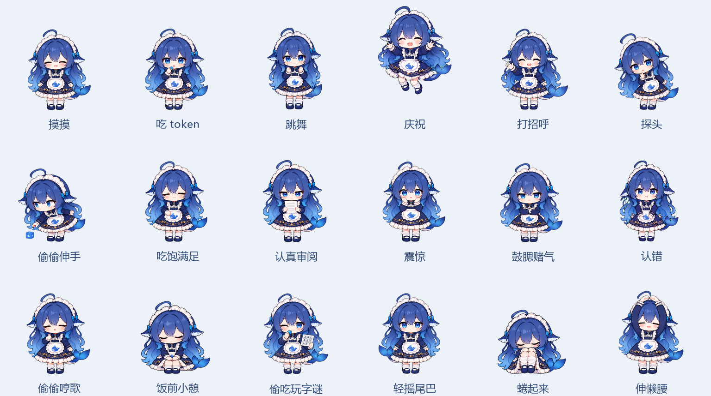

# 统一形象修改版说明

版本：`3.1.0-codex.1`。基于 YunYueSama 的 `codex-deepseek-pet` 修改，原项目与完整许可见仓库根目录。本文描述本修改版，仓库中的上游历史说明不一定反映当前行为。

## 角色与素材

所有新增姿势参考同一标准角色：圆脸、蓝眼睛、蓝色长发、鲸尾、深蓝白金裙装和鲸鱼围裙。吃口粮采用新的完整取食、咀嚼、放手原画；新增表情按各自含义绘制。

素材使用内置 ImageGen 生成，再进行完整角色的等比缩放、平移和图集注册。发色统一仅调整选定头发区域的颜色，保留透明度、原有轮廓和局部明暗。中立入口与出口使用同一张标准站姿。

尺度依据同批标准站姿校准，不按每帧动作的总高度自动放大。偷吃的弯腰姿势保持自然变矮，伸手、抬手和尾巴摆动也不触发自动缩放。原画和精确提示词见 [design/custom-character](../design/custom-character/)。

## 18 个按钮的对应关系

| 按钮 | 动作事件 | 实际表现 |
| --- | --- | --- |
| 摸摸 | `pet` | 放松、眯眼享受，再恢复站姿 |
| 吃 token | `feed` | 接过小 token、送到嘴边、咀嚼、收手 |
| 跳舞 | `dance` | 站姿摇摆舞动 |
| 庆祝 | `celebrate` | 开心起跳、落地、恢复 |
| 打招呼 | `wave` | 抬手挥手，再放下手 |
| 探头 | `peek` | 向两侧探头张望 |
| 偷偷伸手 | `sneak` | 弯腰伸手取 token，拿起偷吃后收手 |
| 吃饱满足 | `satisfied` | 满足地轻拍肚子 |
| 认真审阅 | `review` | 拿起纸张阅读，结束时放下 |
| 震惊 | `shock` | 睁大眼睛、双手靠近脸颊 |
| 鼓腮赌气 | `pout` | 抱臂鼓腮、侧目赌气 |
| 认错 | `sorry` | 委屈认错并恢复站姿 |
| 偷偷哼歌 | `hum` | 闭眼轻哼、手打节拍；无音频 |
| 饭前小憩 | `meal-break` | 坐下打盹、醒来、完整起身 |
| 偷吃玩字谜 | `token-game` | 看字谜卡片时偷偷取食，再放下卡片 |
| 轻摇尾巴 | `tail-sway` | 保持站姿，尾巴左右轻摆 |
| 蜷起来 | `curl` | 坐下抱膝蜷起，再松开、站起 |
| 伸懒腰 | `stretch` | 抬起双臂伸展，再放下 |

## 动作切换

播放器一次只绘制一张完整原画，不做光流补帧、脸部拼接、角色叠化或非等比拉伸。整体平移和轻微倾斜可以连续更新。

动作被打断时，从当前可见姿势收手、放下道具或起身，再进入下一动作。吃饭后段不会因切换而重放一口；小憩和蜷缩也不再借用吃饭或完整睡眠动作。

坐下与起身移除了过低的中间深蹲姿势，避免头部先降再回升。从睡眠进入有限动作时，渲染端回报实际排程结束时间，行为计时据此延长，防止角色还没演完就开始散步。

## 验证与边界

- 123 项资产与逻辑测试通过。
- 实际 Electron 程序验证 18 个按钮及 18 组相邻动作中断切换，全部完成并恢复站姿。
- 25 张图集的 142 个使用帧全部预载，232 次原画渲染比对通过，实际画布始终绘制一张完整原画。
- 本轮重画左右低抬脚步态，删除起步中的两张旧大跨步姿势；分别验证100%尺寸左右320px和50%尺寸左右160px移动，全部8帧连续循环、缩放后反向及停步收势。
- 检查睡眠 → 饭前小憩 → 自然结束 → 散步，移动发生在动作完成和转身之后。
- 对新吃饭与两种偷吃逐帧检查脸型、发色、脚下定位和头部尺度。

步幅由支撑鞋位置标定，左右分别为252/255源像素；100%尺寸移动速度为150屏幕像素/秒，起步和刹车阶段按实际路程放慢步频。收脚选择各方向靠近身体的支撑姿势，再回站姿。小表情验证记录来自上一轮，相关素材在本轮保持一致；最新移动验证见 `custom-walking-validation.json`。

60 Hz 是位置与播放时间线的更新目标，不表示每秒存在 60 张独立原画。行走、跳跃、尾摆和部分表情仍为离散姿势；不同原画间仍可能有细微笔触差异，旧认错姿势的脸部轮廓略有收窄。实际体验会受系统缩放、设备性能和窗口环境影响。

## API 与本机数据

本版保留可选的兼容聊天接口，但不发布维护者的 API 密钥、连接配置、模型选择、聊天记录或本机偏好。使用者需要自行填写配置。

设置和加密凭据保存在当前 Windows 用户的数据目录中，不属于源码或便携程序目录。发布源码忽略这些本机文件；发布包也不携带它们。无需配置 API 即可使用基础桌宠互动。
