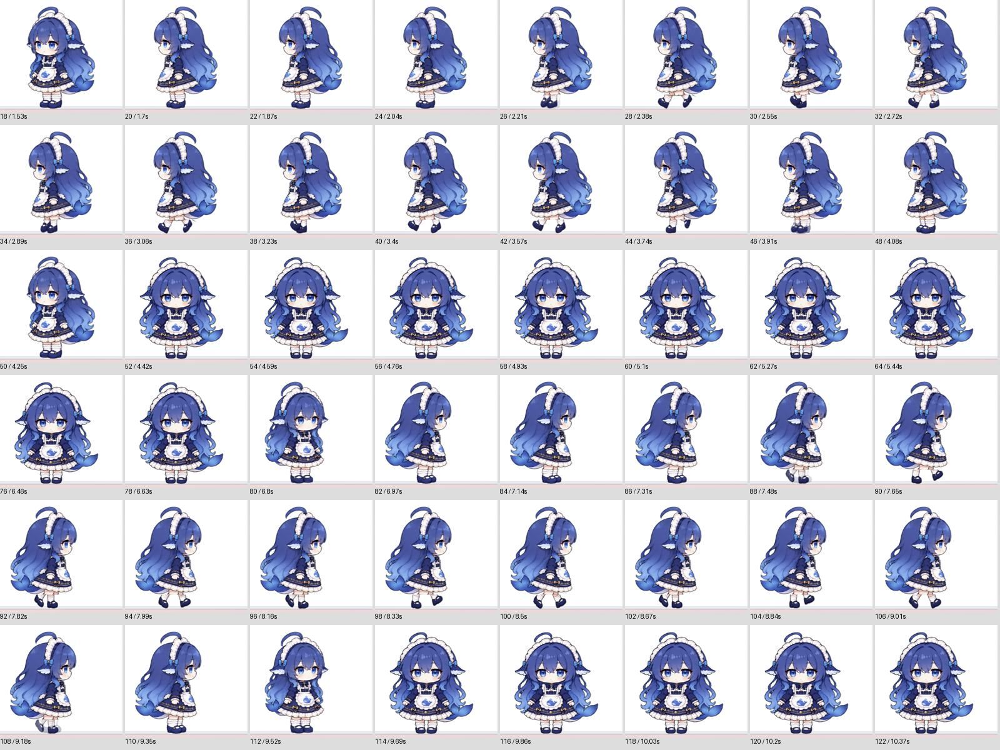

# 3.1.0-codex.2 走动一致性修复

2026-10-25。修改版维护者：michael030528。原项目作者：YunYueSama；原仓库：<https://github.com/YunYueSama/codex-deepseek-pet>。完整许可与素材说明保留在仓库根目录。

## 修复的问题

旧版转身与走路分别使用不同的完整姿势，上身轮廓并不一致：左向起步时头发突然展开、身体变宽；收步时又缩回，随后转向正面。只调整帧时长不能修正这个造型差异。

当前行走上身直接复用对应侧身原画。下肢按原有步态运动，步幅按绘制尺度同步校准；起步先站稳，结束先收脚，再转正。原始素材保持不变。尝试过的 AI 重绘候选未通过比例检查，未纳入发布版。

收脚桥接期间再次反向或连续换向时，恢复路线依据屏幕上的实际方向和当前释放比例继续，避免突然切正面或重新张腿。起步尚未完全展开就停止，也保持可见的腿部比例。

## 可重复的实机演示

右键桌宠或托盘图标，选择“演示左右走动”。演示约13秒，可通过同一菜单停止；用户拖动、交互或更改模式也会取消后续自动返程。电脑闲置较久时先完整站起，演示期间暂停自动睡眠；结束恢复原模式与行为安排，不改变自动散步偏好。

已运行的程序也接受有限演示命令：

```powershell
.\codex-deepseek-pet.exe --walk-preview
```



## 验证

- JavaScript 语法检查通过。
- 完整仓库145项测试通过，包括素材透明边界、步态距离时钟、起停与反向、睡眠起身和演示取消。
- 隔离用户目录的 Electron 冒烟通过，139个所需帧全部载入。
- 左右16个步态 × 5种展开比例，80次像素比较：裙摆上方与对应侧身原画完全一致。
- 38个动作、31,802组转换、254,451次播放采样，无程序检查失败。
- 正式桌宠在150%系统缩放下完成左右往返；屏幕截图复核起步、行走、收步、转正，上身轮廓不再出现此前的跳变。

腿部仍由有限关键姿势组成，位置时钟连续更新不等于每秒60张独立原画。当前修复针对已复现的轮廓跳变和衔接错误，不把程序检查等同于所有设备上的动画观感保证。
